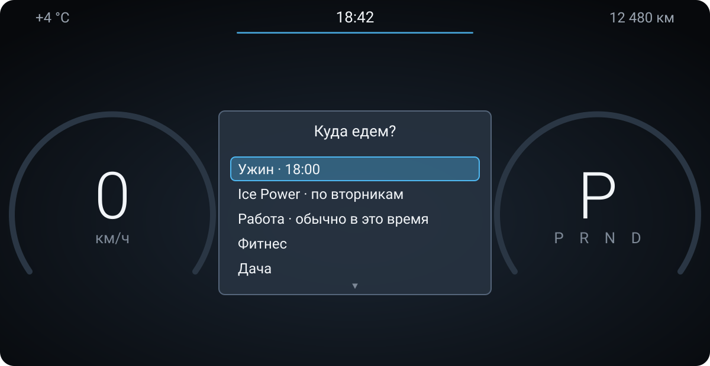
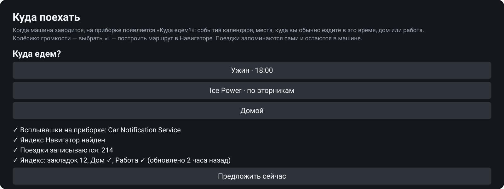

# Куда поехать (route-suggest)

Android-приложение для головного устройства Geely Monjaro (KX11, Android 9). Когда машина
заводится, на приборке появляется список **«Куда едем?»**. Колёсико громкости листает его, ⏯
строит маршрут в Яндекс Навигаторе. Список показывает
[Car Notification Service](https://github.com/smart-car-software/car-notification-service)
(карточка `list`), отвечают кнопками руля.



То же самое — кнопками — в самом приложении на магнитоле, вместе с тем, что подключено:



<sub>Это схемы интерфейса, нарисованные по коду приложения, а не снимки экрана; места и числа
выдуманы.</sub>

## Что предлагается

Сверху вниз, не больше 6 строк и «Не сейчас»:

1. **Календарь.** События, которые идут сейчас или начнутся в течение часа: «Ужин · 18:00»,
   «Совещание · идёт». Календари подключаются в самом приложении (см. ниже).
2. **Привычки.** Место, куда машина ездила в этот день недели примерно в это время (±1,5 ч)
   хотя бы два раза за 10 недель: «Ice Power · по вторникам». Или место, куда за последние три
   недели ездили в это время (±1 ч) хотя бы три дня, отдельно по будням и выходным: «Работа ·
   обычно в это время».
3. **Дом / работа.** Если машина стоит дома — «На работу», иначе — «Домой». Когда выше ничего
   нет, это первая строка.
4. **Частые места.** До трёх мест, куда ездили 3+ раз за 120 дней.

Места, где машина уже стоит (ближе 300 м), не предлагаются. Одно место — одна строка.
Карточка при запуске всплывает, **только если есть событие календаря или привычка** (пункты 1–2):
дом, работа и частые места сами по себе её не вызывают — они в меню приборки. Карточку можно
выключить в приложении («Карточка при запуске»). Висит 45 с. Если Навигатор уже ведёт по
маршруту (например, продолжил его после пробуждения), карточка не показывается. Повторно — не
раньше чем через 10 минут. Кнопка «Предложить сейчас» в приложении показывает её когда угодно,
со всеми строками.

## Меню на приборке

На вкладке навигации штатного меню приборки (переключается кнопками руля) — список всех мест:
события календаря, привычки, дом (или работа, если машина дома), затем закладки Яндекса и
частые места (3+ поездки), по тому, сколько поездок заканчивалось там за 120 дней. Закладки,
куда не ездили, — в конце. Левый джойстик руля листает, нажатие — маршрут и «Поехали». Пока
Навигатор ведёт по маршруту, меню не открывается (на вкладке остаётся карта).

Как это устроено (подсмотрено у mNavi, своего SDK у ECarX нет): системный
`com.ecarx.xui.adaptapi.diminteraction.DimMenuInteraction` сообщает приложению вкладку
(`onTabChanged`, навигация — 2); на этой вкладке джойстик приходит в Android broadcast'ами
`ecarx.intent.action.ECARX_KEY_DIMSCROLLUP_EVENT` / `…DIMSCROLLDOWN…` / `…DIMCONFIRM…`. Сам
список — наше окно поверх дисплея приборки (№ 2) на месте панели вкладки. Нужно разрешение
«поверх окон» — приложение даёт его себе само через root (ADB) или открывает настройки.
«Показать меню на 30 секунд» в приложении — проверить, как оно выглядит.

Названия мест берутся по порядку из закладок и Дома/Работы Яндекса (в радиусе 200 м), из
строки, выбранной для этой поездки, из адреса (OpenStreetMap Nominatim, один запрос на поездку).
Если ничего нет — «Место в 2,3 км».

## Установка

1. Скачать APK из [Releases](https://github.com/smart-car-software/route-suggest/releases) и
   установить. Нужен Car Notification Service (без него список откроется на экране магнитолы).
2. Открыть «Куда поехать» и разрешить геопозицию.
3. **Войти в Яндекс** (по желанию, но так лучше): на экране появится QR-код. Навести на него
   камеру телефона, открыть ссылку и подтвердить вход в приложении Яндекс. Пароль не нужен.
   После этого приложение знает Дом, Работу и закладки и обновляет их раз в 6 часов.
4. **Добавить календарь** (по желанию): выбрать сервис, ввести логин и пароль, отметить
   календари. См. «Календари».
5. **Доступ к уведомлениям Навигатора** (по желанию): тогда приложение видит, что Навигатор
   уже ведёт по маршруту, и не спрашивает зря. В Навигаторе должна быть включена «Фоновая
   навигация».

## Данные Навигатора: что удалось получить

Яндекс Навигатор на Monjaro — обычный `ru.yandex.yandexnavi`, его ставят сами (часто в моде
сообщества с тем же именем пакета). Специальной «автомобильной» сборки с API нет.

- **Наружу Навигатор ничего не отдаёт.** Ни broadcast'ов с маршрутом и назначением, ни
  content provider'а, ни документированных файлов. ECarX-API приборки (`diminteraction`) только
  принимает данные: в него пишут, читать из него нечего.
- **mHUD, mSpeed и подобные.** Исходников и описаний механизма у них нет. Открытый
  [YaNaviPeb](https://github.com/DimaK21/YaNaviPeb) читает уведомление «Фоновой навигации»
  обычного Навигатора: манёвр, расстояние, остаток пути, ETA, без назначения. Но у мода
  30.3.0 на эмуляторе в уведомлении только «Navigator is running», без манёвров, так что
  данные на HUD мод, видимо, отдаёт своим путём (прошивка/мод для приборки).
- **Поэтому поездки пишет само приложение, по GPS.** Старт — где машина стояла, когда тронулась.
  Финиш — где она простояла 5 минут или где выключилась (следующий фикс через 10+ минут).
  Время старта, день недели и координаты хранятся в SQLite на магнитоле. Поездки короче 500 м
  или 2 минут не считаются. Так учитываются и поездки без маршрута (дом ↔ работа обычно ездят
  без Навигатора).
- **Маршруты Навигатора на этой магнитоле — из его собственного файла, через root.** Каждое
  построение маршрута обновляет запись места назначения в локальной базе DataSync Навигатора
  `/data/data/ru.yandex.yandexnavi/files/datasync/.ext.maps_common@ymapspointshistory1/db.sqlite`.
  Таблица `items`: ключи `delta:N` и snapshot, значения — boost::serialization binary.
  В записи `last_used` (мс), `latitude`, `longitude`, `title`, `description`, у организации
  ещё `uri`. Каждое построение даёт две дельты, «Поехали» — третью. Маршрут, построенный руками
  через поиск, попадает туда так же. Найдено на эмуляторе с модом 30.3.0.
  - Приложение копирует базу (и её журнал) через adb магнитолы как root — так же, как
    Car Notification Service читает руль. Копию оно открывает у себя, файл Навигатора не
    трогает: тот держит базу под эксклюзивной блокировкой. Чтение идёт при запуске и после
    каждой поездки.
  - Берутся **только дельты** — изменения на самой магнитоле. Snapshot приходит из аккаунта
    и включает маршруты, построенные на телефоне. Он лишь даёт название месту, которое уже
    есть в дельтах.
  - Построение и «Поехали» в пределах 3 минут — один маршрут. Маршруты копятся у приложения
    (до 1000), потому что дельты исчезают, когда Навигатор синхронизируется.
  - В статистике это поездки с точным назначением, временем и названием. Поездка, записанная
    и по GPS (старт в пределах 30 мин, финиш в пределах 500 м), считается один раз.
  - Включается кнопкой «Подключить историю Навигатора». Нужен ADB по сети (как для MConfig+),
    в первый раз магнитола спросит «Разрешить отладку?».
- **Облачная история Яндекса не используется** (решение пользователя): в ней и маршруты,
  построенные на телефоне, «просто посмотреть, сколько ехать». Из аккаунта берутся только
  закладки, Дом и Работа.
- Ещё в файлах Навигатора: `files/known_route/history` (protobuf: время «Поехали», счётчик
  повторов, геометрия без концов, назначения нет), `shared_prefs/appkit.xml` (только URL-
  интенты от других приложений). Для «куда» они не нужны.
- **Из уведомления Навигатора** (если дан доступ) берётся только «ведёт ли он сейчас по
  маршруту». Поездка помечается как поездка по маршруту, и при запуске приложение не спрашивает.
- **Назначение известно точно**, когда маршрут построен из этого приложения: выбранная строка
  запоминается и даёт имя поездке, если та закончилась в 400 м от неё.
- **Маршрут** (проверено на эмуляторе Android 9 с модом Навигатора 30.3.0, подпись Яндекса не
  нужна):
  - **есть точка** — закладки Яндекса, Дома/Работы, события из календаря с координатами,
    или точка, куда раньше вёл сам Навигатор (обычно вход организации): 
    `yandexnavi://build_route_on_map?lat_to=…&lon_to=…` — обзор маршрута, «Поехали» нажимает
    спецвозможность (ниже). У частого места без закладки и без маршрута Навигатора — середина
    мест, где машина останавливалась;
  - **известны только название и адрес** (закладка-организация без координат, событие с адресом
    — его координаты по OSM Nominatim — середина дома, маршрут к ней может прийти не с той
    стороны): Алиса, `yandexnavi://ask_alice?text=Маршрут до <название, адрес> едем` (так
    делает mNavi). Яндекс сам находит место — берёт первый результат поиска — и сразу ведёт,
    без «Поехали». Нужны сеть и русский язык магнитолы; без сети — по координатам, если они
    есть, иначе поиск;
  - **не годятся**: `rtext` с текстом (Навигатор его игнорирует), `map_search` (кончается
    карточкой или списком, маршрут — пальцем; так и было в машине с v0.6.0). Координаты
    Алисе давать нельзя: она читает их как долготу и широту (повела в Казахстан).
  - Рукопожатие mNavi `ru.yandex.yandexmaps.action.READY_TO_GO` → `…LETS_GO` (ведение без
    спецвозможности) мод 30.3.0 не знает: ни Навигатор его не шлёт, ни ручной `LETS_GO`
    ведение не начинает — нужен другой мод (MonjaroDev). Запасные варианты — Яндекс Карты,
    затем `geo:`.

### Ограничения

- Без root (история Навигатора не подключена) маршрут, построенный в самом Навигаторе,
  приложение по названию не знает: видна только точка, где машина остановилась. Название ей
  даётся по закладкам или по адресу.
- Формат базы Навигатора недокументирован. В другой версии Навигатора он может поменяться, и
  тогда в статусе будет ошибка чтения, а остальное продолжит работать. Если Навигатор
  синхронизируется чаще, чем приложение читает базу (при запуске и после поездки), часть дельт
  уйдёт раньше.
- Признак «ведёт по маршруту» — наличие постоянного уведомления Навигатора
  (`category=navigation`, канал `foreground_notification`, «Navigator is running»). На
  эмуляторе с модом 30.3.0 оно есть только во время ведения, а на карте, в обзоре маршрута и
  после «Завершить» его нет. Манёвров, ETA и назначения в нём нет. В другой версии
  Навигатора поведение может отличаться; тогда пропадёт только этот признак.
- URL-схема только строит маршрут и останавливается на его обзоре, а ведение начинается по
  «Поехали». Чтобы маршрут, выбранный рулём, не требовал касания экрана, «Поехали» нажимает
  спецвозможность приложения (`AutoGoService`, AccessibilityService). Как она работает:
  - взводится, только когда маршрут открыт из карточки «Куда едем?»;
  - 25 секунд смотрит окна Навигатора, ищет кнопку с текстом ровно «Поехали» / «Go» / «В путь»
    и нажимает её один раз;
  - включается кнопкой «Включить спецвозможность» (через root по ADB, иначе открываются
    настройки Android);
  - выключается переключателем «Сам нажимать «Поехали»»;
  - принудительная остановка приложения («Остановить» в настройках, чистильщик памяти)
    выключает спецвозможность — так делает Android; приложение при следующем запуске
    включает её обратно через root (если включало так раньше), как mNavi свои.

  Если Навигатор рисует кнопку без доступной разметки, нажать её не получится, и «Поехали»
  останется за водителем.
- `ActivityManager` пишет в системный logcat запуск Навигатора вместе с URI, то есть с
  координатами назначения или (маршрут через Алису) с адресом. Это системный лог Android,
  обойти его, передавая точку в URI, нельзя.
- Что ещё можно попробовать с root: история и «Мои места» Навигатора лежат в
  `/data/data/ru.yandex.yandexnavi/` (SQLite/кэш DataSync). Это не исследовано: формат
  недокументирован и меняется с версиями. «Мои места» и так приходят через вход в Яндекс.

## Календари

Календари подключаются в самом приложении: «Добавить календарь» → сервис → логин и пароль →
галочки у нужных календарей. Своего сервера посредине нет: машина ходит прямо в календарь.

| Сервис | Логин | Пароль | Как |
|---|---|---|---|
| iCloud | Apple ID | пароль приложения (account.apple.com → «Вход и безопасность») | CalDAV `caldav.icloud.com` |
| Яндекс Календарь | логин Яндекса | пароль приложения «Календарь CalDAV» (id.yandex.ru → «Безопасность») | CalDAV `caldav.yandex.ru` |
| Календарь Mail | почта | пароль для внешнего приложения (id.mail.ru → «Безопасность») | CalDAV `calendar.mail.ru` |
| Exchange (рабочий) | рабочая почта `user@company.ru` (или `ДОМЕН\user`) | обычный | EWS, NTLMv2 или Basic; сервер ищется сам (`exchange.`/`mail.`/`owa.`/`outlook.`/`autodiscover.` домена почты) или указывается адрес веб-почты |
| Другой CalDAV | логин | пароль | адрес сервера (Nextcloud, Synology, Fastmail…) |

Где взять пароль приложения, написано на экране входа, рядом — QR на нужную страницу:
навести телефон, создать пароль, ввести на магнитоле. Пароли хранятся в настройках
приложения, зашифрованные ключом из Android Keystore.

**Google Календарь** по паролю не подключить: Google пускает только через свой OAuth, а для
него нужно зарегистрированное в Google Cloud приложение. Обходной путь — подписаться на
календарь Google из iCloud или Яндекс Календаря и подключить тот. По той же причине не
подходят Microsoft 365 и Outlook.com: Microsoft отключил вход по паролю.

Что берётся из календаря: события, которые идут сейчас (начались не раньше 12 часов назад)
или начнутся в течение часа. Отсеиваются события на весь день, «свободно» и отменённые,
видеозвонки (ссылка, Zoom, Телемост…), а в рабочем календаре — место, не похожее на адрес
(переговорка). Куда ехать, определяется так:
1. координаты события (GEO, булавка iCloud — её ставит iPhone, когда место выбрано из подсказки);
2. закладка или Дом/Работа Яндекса, названные в месте или в названии события;
3. просто адрес. Приложение находит его координаты в OpenStreetMap (Nominatim): берётся
   ближайший к машине результат, не дальше 100 км, найденное запоминается. Тогда Навигатор
   сразу строит маршрут. Если адрес не нашёлся, Навигатор только ищет его, и дальше нужен
   экран: с руля результат поиска не выбрать.

Копии одного события в двух календарях дают одну строку. Повторы разворачивает сервер
(`expand`). Если он этого не умеет, их разворачивает приложение: DAILY, WEEKLY, MONTHLY, YEARLY с
INTERVAL, COUNT, UNTIL, EXDATE, перенесёнными повторами. Нет сети — при запуске приложение ждёт
её до ~40 с, потом календарь пропускается, остальное работает. Ошибка аккаунта (например,
сменился пароль) видна на главном экране.

## Данные и приватность

Поездки — только в машине (SQLite приложения, «Забыть все поездки» удаляет их). Сессия Яндекса
хранится в личных файлах приложения, «Выйти из Яндекса» её удаляет. Пароли календарей
зашифрованы ключом Android Keystore, «Отключить» у календаря их удаляет. Приложение не пишет
в logcat координаты, адреса и названия (кроме системной строки запуска Навигатора, см. выше).

## Сборка

```bash
./gradlew testDebugUnitTest assembleDebug
```

Тег `v*` запускает `.github/workflows/release.yml`: сборка, тесты, GitHub Release с
`route-suggest-<tag>.apk`. Подпись — `KEYSTORE_BASE64` / `KEY_PASSWORD` (PKCS12, alias `key0`).
